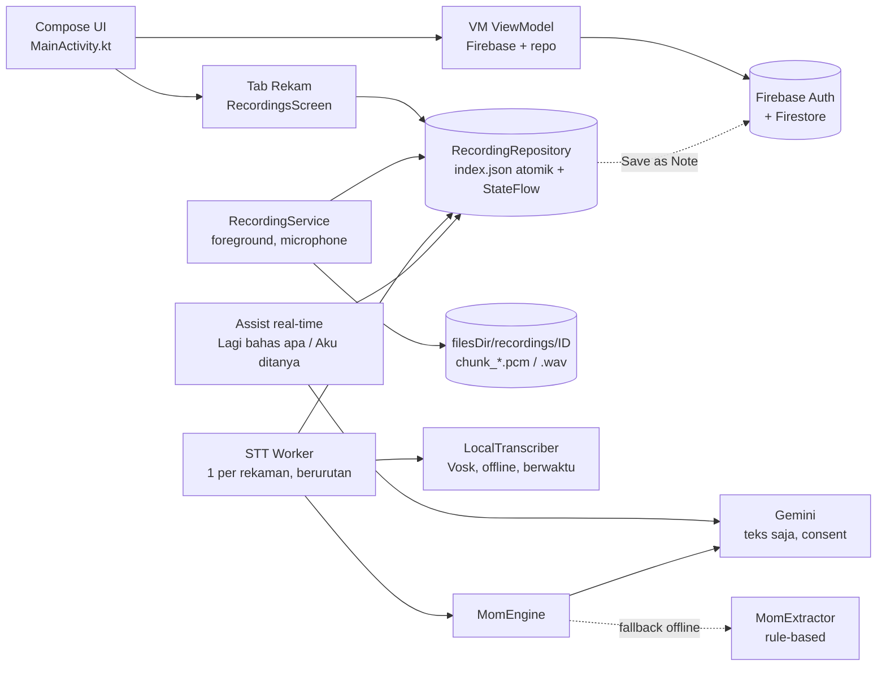
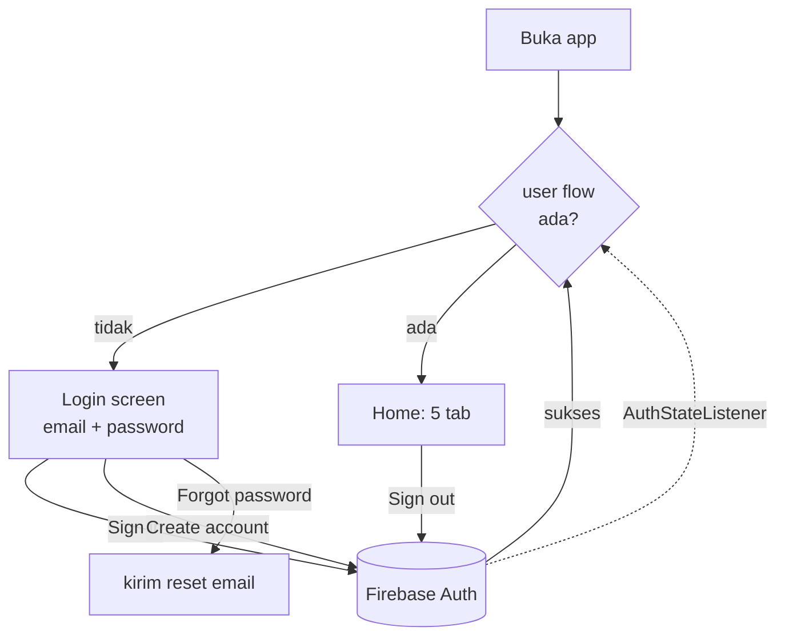
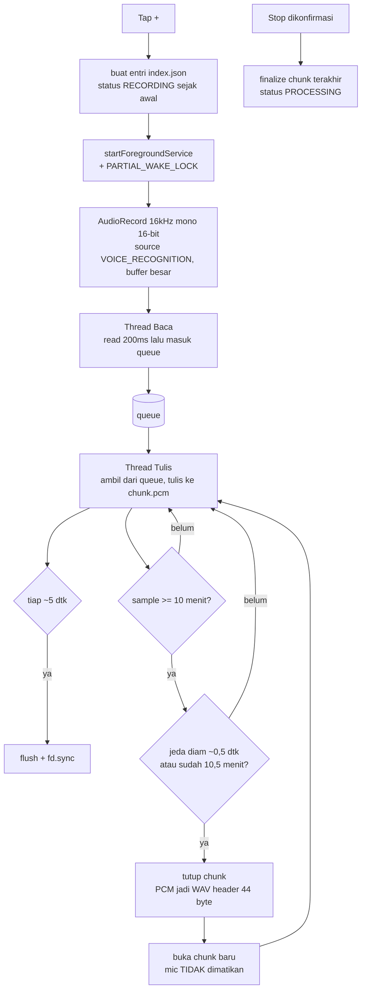
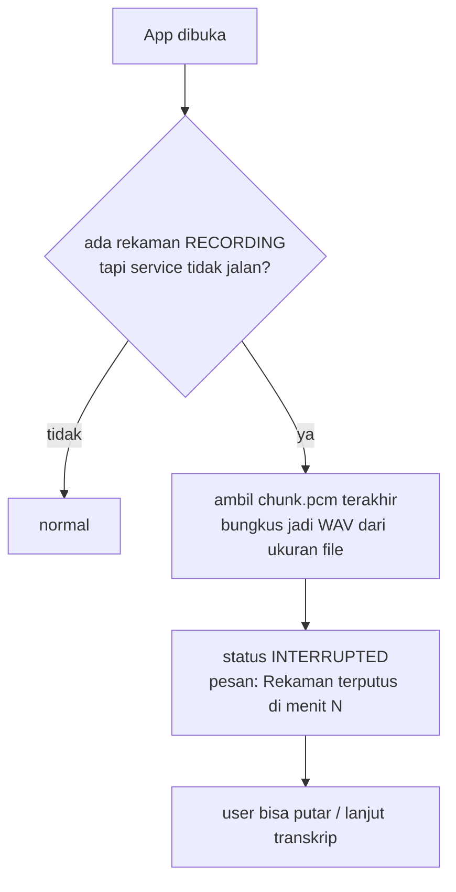
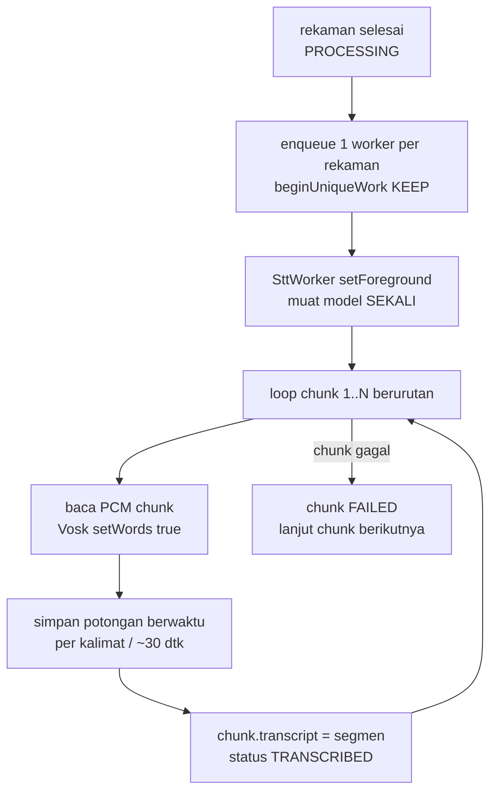
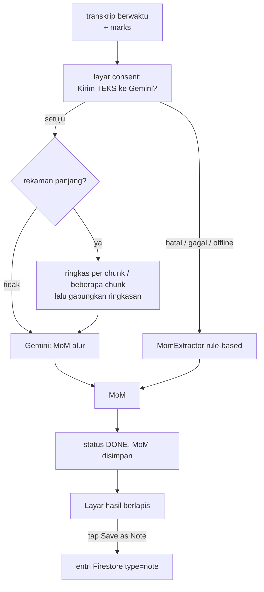
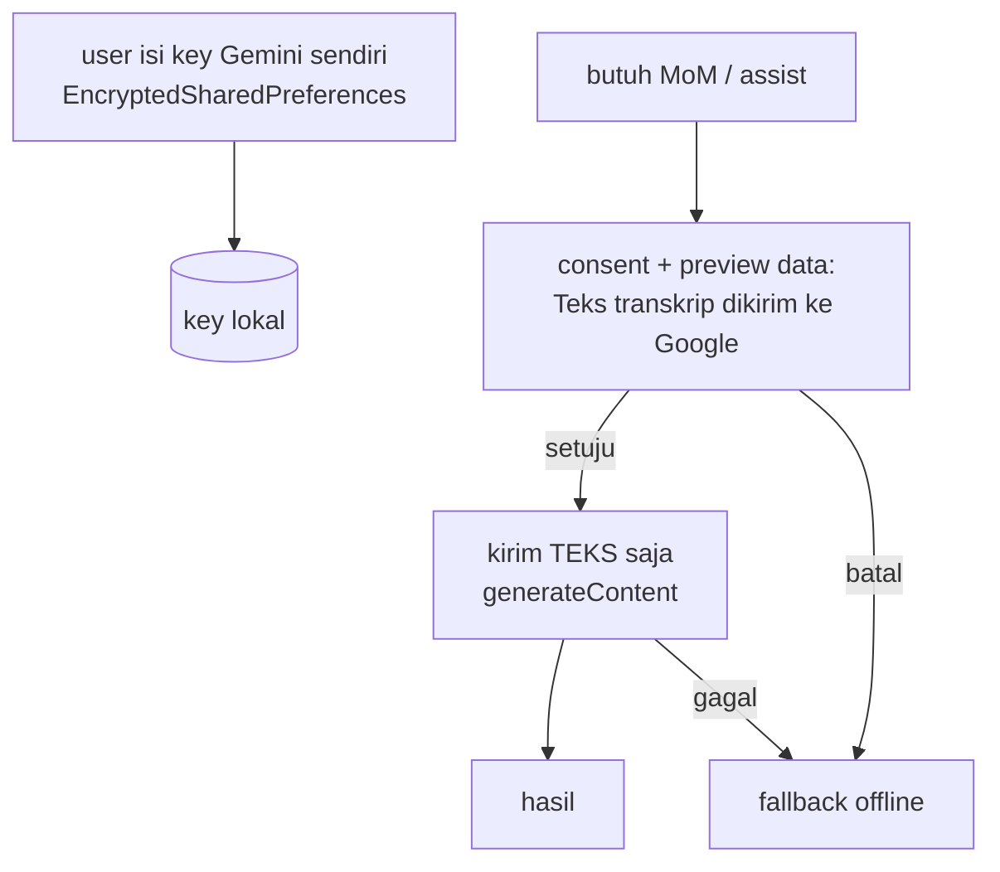
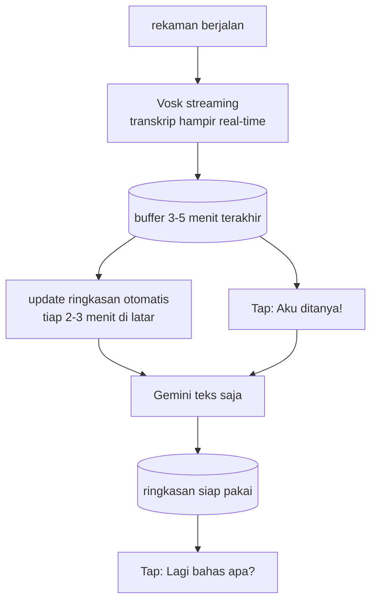

# Daybook — System Flow (per fitur) · Revisi 2

Dokumen ini menjelaskan alur tiap fitur Daybook: komponen, aliran data, status, dan risiko.
Tujuannya supaya gampang dianalisa, bukan menggantikan kode.

> Konvensi status: ✅ sudah jalan di kode · 🏗 sedang dibangun (sudah di-push, blm diuji
> di device) · 📋 belum dibangun · 🚧 legacy/sementara (perlu dirapikan) · 🔧 perlu perbaikan

## Perubahan di revisi ini

Fokus produk bergeser: dari **"app perekam + notulen"** menjadi **"asisten yang membantu
mengikuti meeting, saat meeting dan sesudahnya"**.

| Area | Dulu | Sekarang |
|---|---|---|
| Tujuan produk | Notulen dari rekaman | Membantu mengikuti obrolan banyak orang (saat + sesudah meeting) |
| Recording | WAV chunk, header dipatch saat tutup | PCM mentah, flush berkala, mic tidak pernah dimatikan, recovery otomatis |
| Potong chunk | Tepat ~10 menit | Setelah 10 menit, potong di jeda diam (maks 10,5 menit) |
| Tandai | Tidak ada | Tombol Tandai (Bingung / Penting), disimpan sebagai `marks[]` |
| STT | Teks satu blok, worker paralel | Transkrip berwaktu, berurutan (1 worker per rekaman) |
| MoM | Rule-based | Berbasis alur via Gemini (teks saja, consent); rule-based = fallback offline |
| Gemini | Opsional, pinggiran | Jalur utama MoM dan fitur real-time |
| Saat meeting | Tidak ada | "Lagi bahas apa?", "Aku ditanya!", penjelasan istilah |
| UX | Dialog judul dulu, layar biasa | Tap langsung rekam, layar minim, hasil berlapis |
| Mic di Notes | Ada (legacy) | Disembunyikan; satu jalur rekam (tab Rekam) |

---

## 0. Peta komponen & arsitektur



Prinsip:
1. **Audio asli lokal = sumber kebenaran.** Firebase hanya untuk Notes/Timebox/Dreams/Bucket.
2. **Tiap detik audio harus sudah di disk** sebelum detik berikutnya direkam.
3. **Cloud (Gemini) hanya menerima TEKS transkrip**, bukan audio, dengan layar consent. Key milik user, tidak hardcoded.
4. **Tidak mengarang.** Kalau tidak jelas → "perlu konfirmasi". Tidak menebak nama pembicara.

Data dir: `filesDir/recordings/` (permanen). `cacheDir` TIDAK dipakai untuk audio. Audio tidak
dihapus otomatis (hapus manual oleh user, dengan tampilan ukuran per rekaman).

---

## 1. Autentikasi (Firebase Auth)

**Status:** ✅ (tidak berubah)



- Data Firestore di `users/{uid}/entries/{entryId}`; hanya pemilik uid yang bisa akses.
- Logout tidak menghapus rekaman lokal.

---

## 2. Notes (type=`note`)

**Status:** ✅ (simpan) · 🚧 AI Review dinonaktifkan · mic di Notes → **disembunyikan**

- Editor rich text, auto-save debounce 2 detik ke Firestore.
- **Mic di NoteEditor disembunyikan/dihapus.** Satu jalur rekam saja (tab Rekam) agar tidak
  ada dua sumber bug dan tidak ada risiko dua rekaman aktif bersamaan.
- AI Review kembali nanti lewat jalur Gemini opsional (§9).

---

## 3. Timebox (type=`block`) · 4. Dreams (type=`dream`) · 5. Bucket List (type=`bucket`)

**Status:** ✅ (tidak berubah)

- Timebox: navigasi hari, centang `done`, editor judul/start/end.
- Dreams: tag tipe (Normal/Recurring/Nightmare/Lucid), sleep 1-5, date picker.
- Bucket: siklus status Dream → Planned → Done dengan 1 tap, target year opsional.

---

## 6. Recording (foreground service, chunk, tahan crash)

**Status:** 🏗 kode sudah direvisi (PCM, tanpa gap, recovery, Tandai, wake lock), **belum diuji di device**

### 6.1 UX saat rekam

Prinsip: saat meeting tidak ada kapasitas untuk mengurus app → **satu tap, tanpa mengetik**.

```
        ● Merekam   42:15

   [ ⭐ Bingung ]   [ ⭐ Penting ]     ← besar, mudah kena jempol

   ▂▃▅▂▁▃▆▃▂   (indikator suara hidup)

   (tombol "Lagi bahas apa?" / "Aku ditanya!" menyusul, §11 — belum ada)

              [ Stop ]  (kecil, jauh dari Tandai, perlu konfirmasi)
```

- Tap **+** langsung rekam. Judul otomatis ("Meeting 7 Nov 14:00"), diedit belakangan.
- Izin mic dan notifikasi diminta saat tap pertama (onboarding khusus belum ada). Izin notifikasi
  **bukan syarat** merekam (kalau ditolak, rekaman tetap jalan).
- Kartu tips pengaturan baterai Xiaomi/POCO tampil di tab Rekam sampai user menekan "Sudah diatur".
- **Getar singkat** saat Tandai ditekan. **Indikator suara** menunjukkan mic benar-benar menangkap.
- Tandai bisa ditekan dari **notifikasi rekaman** (juga di layar kunci). Notifikasi **sengaja tanpa tombol Stop**.
- Stop hanya di dalam app dan butuh tap kedua (konfirmasi 3 detik).

### 6.2 Alur perekaman (tanpa gap, dua thread)



Aturan penting:
- **Rotasi berdasarkan jumlah sample**, bukan jam dinding (16000 × 600 = 9.600.000 sample).
- Ambang diam **adaptif** (2-3× noise terendah beberapa detik terakhir), bukan angka tetap.
- Chunk ditulis sebagai `.pcm` tanpa header dulu → tidak ada header setengah jadi yang korup.
- Pantau panjang queue; kalau terus membesar, catat peringatan (disk tidak mengejar).
- Cek sisa storage sebelum dan selama merekam; berhenti rapi kalau hampir habis.
  (16kHz mono 16-bit ≈ 1,9 MB/menit; 12 jam ≈ 1,4 GB ≈ 72 chunk.)
- Durasi dihitung dari jumlah sample.
- Guard: hanya satu rekaman aktif.

### 6.3 Tombol Tandai

- Simpan `marks[] = { offsetDetik, tipe: BINGUNG | PENTING, catatan? }`. Offset dari jumlah
  sample, sehingga cocok dengan audio dan transkrip.
- Catatan opsional hanya diisi **setelah** rekaman, tidak saat meeting.

### 6.4 Recovery & ketahanan



| Kejadian | Yang hilang |
|---|---|
| App crash / di-kill sistem | ±5 detik terakhir |
| HP mati / baterai habis | ±5 detik terakhir |
| Service dimatikan MIUI | ±5 detik terakhir, status INTERRUPTED |
| Telepon / mic diambil app lain | Audio selama mic diambil (kosong) |

- `index.json` ditulis **atomik** (tulis temp lalu rename).
- Deteksi data nol terlalu lama (>10 detik) → peringatan di layar dan notifikasi.
- Chunk yang selesai = WAV utuh. Kalau recovery bug, rugi maksimal chunk yang sedang berjalan.

### 6.5 Perbaikan Android yang wajib

- 🏗 `ACTION_STOP` dan `ACTION_MARK` dikirim dengan `startService` biasa, **bukan** `startForegroundService`
  (hindari `ForegroundServiceDidNotStartInTimeException`). Hanya `ACTION_START` memakai `startForegroundService`.
- 🏗 Android 14+: manifest punya `FOREGROUND_SERVICE_MICROPHONE`; `startForeground` diberi tipe microphone.
- 🏗 POCO M5 (MIUI/HyperOS): `PARTIAL_WAKE_LOCK` selama merekam + kartu tips (Autostart, baterai
  "Tanpa batasan", kunci app di recents). Service yang mati sendiri terdeteksi saat app dibuka lagi
  (RECORDING tanpa service aktif → salvage → INTERRUPTED).
- 🏗 Interupsi: `AudioRecordingCallback` (API 29+, mic diambil app lain) + deteksi data semua nol >10 detik.
  Sumber audio `VOICE_RECOGNITION` (bukan `VOICE_COMMUNICATION`, AGC/echo-cancel merusak akurasi STT).
- 🏗 Auto Backup: folder `recordings/` dan model Vosk dikecualikan (kuota ±25 MB, bisa gagal diam-diam).
  Backup nyata = export (§10).

**Status rekaman:** `RECORDING → PROCESSING → DONE | FAILED | INTERRUPTED | PARTIAL`.
**Status chunk:** `RECORDED → TRANSCRIBING → TRANSCRIBED | FAILED` (retry per chunk).

**Risiko/blm diuji:** service saat layar mati di POCO M5; panas dan baterai pada rekaman 1-2 jam;
kualitas potong di jeda diam; notifikasi di Android 14+.

---

## 7. STT lokal (Vosk, berwaktu, berurutan)

**Status:** 📋 (sudah ada `LocalTranscriber.kt` + dep Vosk, blm di-wire)



- **Berurutan, bukan paralel.** Satu worker per rekaman, model Vosk dimuat sekali (hindari OOM
  dan panas di 4GB). `setForeground` supaya tidak dibunuh sistem setelah ±10 menit.
- **Output berwaktu**: daftar `{startDetik, endDetik, teks}`, bukan satu string. Ini syarat
  fitur alur per waktu dan lompat ke momen.
- Model `vosk-model-small-id` (~40MB) diunduh sekali, lalu offline. Akurasi POC-grade; tidak ada
  pemisahan pembicara.
- Kata terpotong di batas chunk: dikurangi oleh potong-di-jeda-diam. Overlap 3 detik saat
  membaca untuk STT = opsi versi berikutnya kalau di tes sering terjadi.
- Chunk gagal tidak menahan semuanya: ada opsi **"lanjut tanpa chunk gagal"** dan retry per chunk.
- Mode streaming (hampir real-time) untuk §11 dibahas di sana.

---

## 8. MoM berbasis alur (Gemini) + Save as Note

**Status:** 📋 belum dibangun



**Isi MoM (fokus alur, bukan notulen formal):**
- **Alur obrolan**: topik per segmen waktu ("00:00-08:00 anggaran", "08:00-19:00 jadwal", ...)
- **Keputusan** (dan alasannya)
- **Action item**
- **Perlu konfirmasi** (hal yang tidak jelas)
- **Sekitar penandamu**: penjelasan alur di sekitar tiap ⭐

**Aturan prompt Gemini:**
- Output format tetap (JSON) agar mudah ditampilkan dan diedit.
- Jangan mengarang; kalau tidak jelas tulis "perlu konfirmasi".
- Transkrip dari STT tidak sempurna dan tanpa nama pembicara; jangan menebak siapa yang bicara.
- Sertakan `marks` agar area penanda dijelaskan lebih rinci.
- Rekaman panjang: hierarkis (per chunk dulu, lalu gabung).

**Layar hasil (berlapis):**

```
Lapis 1 (selalu terlihat): Alur obrolan 3-5 baris + timeline visual dengan ikon ⭐
Lapis 2:                   Keputusan, Action item, Perlu konfirmasi (menonjol)
Lapis 3 (tap untuk buka):  Transkrip + audio di segmen itu (putar dari -10 detik)
```

- Tiap kalimat MoM punya ikon 🔊 untuk dengar bagian aslinya (verifikasi).
- Label: "Dibuat dari transkrip otomatis, bisa ada salah".
- **Save as Note** wajib tap eksplisit (tidak menimpa note user).

---

## 9. Gemini (jalur utama, teks saja)

**Status:** 📋 belum dibangun · prioritas dinaikkan



- Key disimpan lokal oleh user, BUKAN hardcoded di kode/APK.
- Hanya **teks transkrip** (bukan audio). Layar consent + preview.
- Model `gemini-2.5-flash` atau setara. Gagal → tetap ada hasil lokal.
- **Syarat non-teknis:** cek kebijakan kantor soal mengirim isi meeting ke layanan eksternal,
  dan izin merekam peserta. Bisa menentukan apakah jalur ini boleh dipakai sama sekali.

---

## 10. Backup & export

**Status:** 📋 · prioritas dinaikkan (prinsip "audio lokal = sumber kebenaran" butuh cadangan)

- **Tahap 1:** Export/Share per rekaman (audio + transkrip + MoM + marks) sebelum STT.
- **Tahap 2:** Backup zip (ditulis streaming, tidak dimuat ke memori) + validasi saat import.
- Cek konfigurasi Auto Backup Android (filesDir bisa ikut terbackup dengan batas ukuran).
- File di `filesDir` hilang kalau uninstall/HP rusak. Backup cloud tidak otomatis.

---

## 11. Assist saat meeting (fitur inti)

**Status:** 📋 belum dibangun · belum terbukti bisa dibangun di POCO M5

Menjawab masalah utama: bingung arah obrolan dan freeze saat ditanya, **saat** meeting berlangsung.



**Tombol 1 — Lagi bahas apa?** Layar sangat singkat, huruf besar, bisa dibaca 2 detik:

```
Sekarang: Testing fitur
Tadi: Jadwal peluncuran (belum diputuskan)
```

**Tombol 2 — Aku ditanya!**

```
Pertanyaan terakhir (menit 20:40):
"Kalau testing selesai tanggal 18, apakah tim kamu siap untuk peluncuran tanggal 20?"

Konteks singkat:
- Peluncuran disepakati tanggal 20
- Testing sedang dibahas, belum ada kepastian

Kalimat aman:
• "Boleh diulang pertanyaannya?"
• "Saya cek dulu kesiapan tim, nanti saya konfirmasi sore ini."
```

**Penjelasan istilah (📋 belum dirancang detail):** istilah asing di beberapa menit terakhir
dijelaskan singkat.

**Aturan:**
- Selalu tampilkan **kalimat asli transkrip** di samping ringkasan (STT bisa salah dengar).
- Tanpa pemisahan pembicara: "pertanyaan terakhir yang terdengar", bukan kepastian bahwa
  itu ditujukan ke user.
- Kalau tidak ada pertanyaan jelas → tampilkan kalimat aman saja, jangan menebak.
- Ringkasan diperbarui di latar supaya saat dilirik sudah siap (hindari latensi 3-10 detik).

**Tantangan:** akurasi Vosk small untuk obrolan banyak orang, panas/baterai di POCO M5 4GB,
butuh internet saat meeting, layar HP saat meeting (perlu tampilan tidak mencolok), dan kebijakan
kantor soal data.

---

## Ringkasan status per fitur

| Fitur | Status | Catatan |
|---|---|---|
| Auth | ✅ | Firebase email/password |
| Notes (simpan) | ✅ | Firestore, rich text, auto-save |
| Notes AI Review | 🚧 | dinonaktifkan, balik via §9 |
| Notes mic | ✅ | tombol mic dihapus dari NoteEditor, satu jalur rekam |
| Timebox / Dreams / Bucket | ✅ | Firestore |
| Recording service + chunk | 🏗 | direvisi: PCM, 2 thread, jeda diam, recovery, wake lock. **Blm diuji device** |
| Tombol Tandai | 🏗 | Bingung/Penting di layar + notifikasi, getar. Blm diuji |
| UX layar rekam | 🏗 | tap langsung rekam, layar minim, indikator suara, Stop konfirmasi |
| Tab Rekam + status | 🏗 | label jujur "Transkrip belum tersedia", ganti judul, hapus manual + ukuran |
| Export per rekaman | 📋 | naik prioritas |
| STT Vosk berwaktu | 🏗 | `SttWorker` berurutan + transkrip berwaktu sudah ada; jalan otomatis setelah rekam/recovery. Blm diuji device |
| MoM alur (Gemini) | 🏗 | `GeminiClient` + model `MoM` ada (key terenkripsi lokal). **Belum ada** layar consent, input key, tombol "buat MoM" |
| MoM rule-based | 🏗 | `MomExtractor` versi berwaktu ada; belum dipanggil dari UI |
| Layar hasil berlapis + lompat | 📋 | belum ada UI untuk melihat transkrip/MoM/penanda (data sudah tersimpan) |
| Save as Note | 📋 | wajib tap eksplisit |
| Gemini (teks, consent) | 🏗 | client ada; consent + input key belum |
| Lagi bahas apa? / Aku ditanya! | 📋 | fitur inti, perlu bukti kelayakan |
| Penjelasan istilah | 📋 | belum dirancang detail |
| Backup/restore zip | 📋 | tahap 2 |

---

## Urutan kerja yang disarankan

0. **Tes manual (tanpa kode)** di 1-2 meeting: rekam dengan recorder bawaan, catat jam bingung,
   simulasikan ringkasan 3 menit lewat Gemini/Claude, nilai apakah membantu. Cek izin peserta
   dan kebijakan kantor.
1. Tes stabilitas rekaman di device (30/60 menit layar mati, swipe recents, telepon masuk,
   Bluetooth, storage hampir penuh, Android 14 izin notifikasi ditolak, cek gap di batas chunk).
2. Perbaikan recovery (PCM, index atomik, INTERRUPTED), `ACTION_STOP`, izin A14, pengaturan MIUI.
3. Tombol Tandai + UX layar rekam.
4. Export per rekaman.
5. STT berwaktu, berurutan.
6. MoM alur via Gemini (bandingkan dengan rule-based di satu meeting nyata) + layar hasil.
7. Assist real-time (§11).
8. Penjelasan istilah, backup zip.

---

## Pertanyaan terbuka (status)

1. ~~Mic di Notes~~ → **diputuskan:** disembunyikan, satu jalur rekam.
2. Chunk 10 menit: pertahankan; turunkan ke 5 menit kalau tes thermal di POCO M5 buruk.
3. ~~Save as Note~~ → **diputuskan:** wajib tap eksplisit.
4. ~~Gemini fallback~~ → **diputuskan:** teks saja, jalur utama dengan consent.
5. Backup: zip cukup; mulai manual per rekaman, otomatis belakangan.
6. ~~Tab Rekam~~ → **diputuskan:** tetap tampil dengan label jujur.
7. **Baru:** apakah kantor mengizinkan teks meeting dikirim ke Gemini?
8. **Baru:** apakah transkrip Vosk small cukup terbaca untuk meeting nyata? (tes dulu sebelum §8 dan §11)
9. **Baru:** apakah pemisahan pembicara perlu dipikirkan setelah versi pertama dipakai?
10. **Baru:** tampilan assist di meeting: bagaimana agar tidak terlihat mengganggu (HP miring di meja, layar ringkas)?
